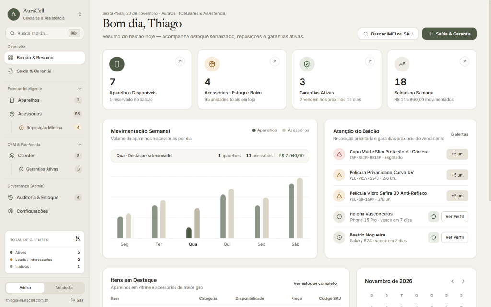
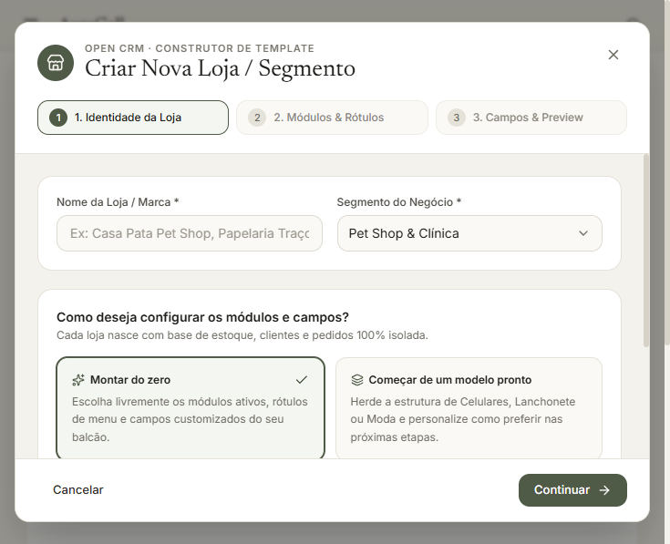
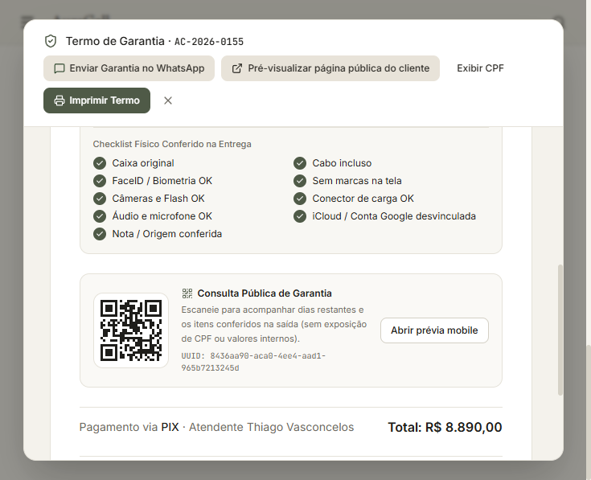
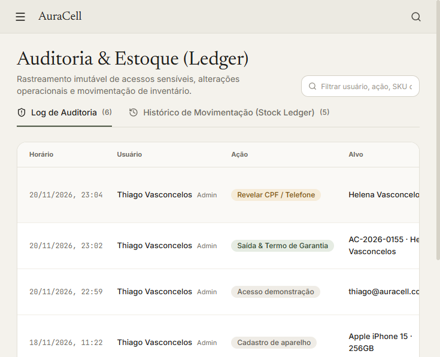

# OpenCRM — Plataforma SaaS Multi-Tenant Metadata-Driven, Vercel Serverless, Supabase PostgreSQL 17 RLS & AppSec LGPD

> **Arquitetura Full-Stack Corporativa:** Frontend React 19 + TypeScript + Tailwind CSS (*Warm Editorial Boutique Design System*) integrado a Backend Fastify encapsulado em **Vercel Serverless Function** (`api/index.ts`), banco de dados **PostgreSQL 17 gerenciado no Supabase** com **Row-Level Security (RLS) mandatória**, blindagem de dados sensíveis (**LGPD**) via Blind Index HMAC-SHA256 e criptografia AES-256-GCM, transações **ACID** com proteção contra race conditions e motor dinâmico de templates metadata-driven.

---

### 🌐 Ambientes Oficiais em Produção (Live)

| Recurso | Destino / Status | Link de Acesso |
| :--- | :--- | :--- |
| **Aplicação Web (Produção)** | **Vercel Live (Full-Stack SPA + Serverless)** | 👉 **[https://opencrm-ashy.vercel.app](https://opencrm-ashy.vercel.app)** |
| **Backend API (Healthcheck)** | Rota Leve Zero-Leak (`GET /api/health`) | **[https://opencrm-ashy.vercel.app/api/health](https://opencrm-ashy.vercel.app/api/health)** |
| **Banco de Dados Relacional** | Supabase Cloud (PostgreSQL 17 com RLS real) | `strzjawgrmdefpjioqcj.supabase.co` |
| **Repositório Oficial** | GitHub Oficial (Branches `main` e `dev`) | **[https://github.com/ThiagoIbrahimVieira/opencrm](https://github.com/ThiagoIbrahimVieira/opencrm)** |

---

## 📸 Vitrine Visual do Sistema (Produção)

Abaixo estão as evidências reais de funcionamento capturadas no ambiente de produção oficial do OpenCRM:

| Balcão & Resumo Operacional | Motor de Templates (Store Wizard) |
| :---: | :---: |
|  |  |
| **1. Visão Executiva & Balcão:** Painel operacional com métricas em tempo real, volume de vendas, atalhos ágeis de atendimento e monitoramento de estoque mínimo em estética *Warm Editorial Boutique*. | **2. Motor Metadata-Driven:** Assistente dinâmico de lojas que permite configurar campos personalizados, regras de serialização, tolerâncias e validações Zod sem alterar o schema do banco. |

| Checkout Transacional & Termo com QR Code | Governança, Livro Razão & Auditoria LGPD |
| :---: | :---: |
|  |  |
| **3. Saída com Blind Index & Comprovante:** Busca instantânea por CPF criptografado, baixa atômica de estoque, geração de termo com QR Code vetorial SVG e compartilhamento nativo via WhatsApp. | **4. Trilha Imutável de Auditoria (LGPD):** Registro criptográfico de acessos a PII (revelação de CPF/Telefone com log de IP e ator), além do Livro Razão (*Stock Ledger*) de movimentações. |

---

## 📚 Índice de Documentação Modular

Toda a documentação técnica foi estruturada de forma modular para permitir consulta aprofundada por tópico:

1. [**1. Visão Geral e Problema Resolvido**](#1-visão-geral-e-problema-resolvido) — [Acessar Documento Completo (`docs/01-visao-geral.md`)](docs/01-visao-geral.md)
2. [**2. Topologia Arquitetural 100% Vercel Serverless Function + Supabase RLS**](#2-topologia-arquitetural-100-vercel-serverless-function--supabase-rls) — [Acessar Documento Completo (`docs/02-topologia-arquitetural.md`)](docs/02-topologia-arquitetural.md)
3. [**3. Segurança da Informação & Engenharia LGPD By Design**](#3-segurança-da-informação--engenharia-lgpd-by-design) — [Acessar Documento Completo (`docs/03-seguranca-e-lgpd.md`)](docs/03-seguranca-e-lgpd.md)
4. [**4. Diagrama Entidade-Relacionamento (DER)**](#4-diagrama-entidade-relacionamento-der) — [Acessar Documento Completo (`docs/04-diagrama-entidade-relacionamento.md`)](docs/04-diagrama-entidade-relacionamento.md)
5. [**5. Stack Tecnológica Completa**](#5-stack-tecnológica-completa) — [Acessar Documento Completo (`docs/05-stack-tecnologica.md`)](docs/05-stack-tecnologica.md)
6. [**6. Como Executar o Projeto Localmente**](#6-como-executar-o-projeto-localmente) — [Acessar Documento Completo (`docs/06-execucao-local.md`)](docs/06-execucao-local.md)
7. [**7. Execução da Suíte de Testes e Validação de Tipagem**](#7-execução-da-suíte-de-testes-e-validação-de-tipagem) — [Acessar Documento Completo (`docs/07-testes-e-qualidade.md`)](docs/07-testes-e-qualidade.md)
8. [**8. Pipeline de CI/CD (GitHub Actions)**](#8-pipeline-de-ci-cd-github-actions) — [Acessar Documento Completo (`docs/08-pipeline-ci-cd.md`)](docs/08-pipeline-ci-cd.md)
9. [**9. Licença**](#9-licença) — [Acessar Documento Completo (`docs/09-licenca.md`)](docs/09-licenca.md)

---

## 1. Visão Geral e Problema Resolvido
> 📄 **Documentação Detalhada:** Leia a análise de concorrência, dores de sistemas engessados e a fundação da solução em [`docs/01-visao-geral.md`](docs/01-visao-geral.md).

O **OpenCRM** supera a dicotomia entre ERPs legados engessados e soluções No-Code frágeis unindo **Multi-Tenancy com Row-Level Security no PostgreSQL 17**, um **Motor de Templates Dinâmico (`JSONB` + Zod)** para qualquer segmento (celulares, alimentação, moda ou serviços), conformidade obrigatória com a **LGPD** e transações **ACID anti-concorrência** no PDV.

---

## 2. Topologia Arquitetural 100% Vercel Serverless Function + Supabase RLS
> 📄 **Documentação Detalhada:** Consulte os diagramas completos Mermaid e ASCII, barreira assíncrona serverless e pooling em [`docs/02-topologia-arquitetural.md`](docs/02-topologia-arquitetural.md).

Arquitetura unificada em **Vercel Edge Network & Serverless Platform**, roteando requisições estáticas para Edge CDN e chamadas `/api/:path*` para **Fastify em Node.js 22** (`api/index.ts`). A persistência conecta-se via **Supabase Transaction Pooler (porta 6543 / PgBouncer)** com RLS forçada (`FORCE ROW LEVEL SECURITY`) e role de banco não-privilegiada `opencrm_app`.

---

## 3. Segurança da Informação & Engenharia LGPD By Design
> 📄 **Documentação Detalhada:** Veja as fórmulas matemáticas do Blind Index, vetores AES-256-GCM e trilha de auditoria em [`docs/03-seguranca-e-lgpd.md`](docs/03-seguranca-e-lgpd.md).

Conformidade nativa com a **Lei nº 13.709/2018 (LGPD)**:
* **Blind Index HMAC-SHA256:** Busca instantânea e deduplicação de CPFs em tempo $O(1)$ sem expor dados e sem descriptografar tabelas.
* **Criptografia Simétrica AES-256-GCM:** Cifragem com IV aleatório de 12 bytes e Auth Tag de 16 bytes para CPFs e telefones.
* **Trilha Imutável de Auditoria (Art. 18):** Registro perpétuo em `audit_logs` de qualquer revelação de PII (com IP real, ator, cargo e timestamp).
* **Proteção de Sessão:** Cookies `HttpOnly`, `SameSite=Lax`, `Secure` e rotação RFC 6819 de refresh tokens.

---

## 4. Diagrama Entidade-Relacionamento (DER)
> 📄 **Documentação Detalhada:** Inspecione o diagrama relacional completo, chaves estrangeiras e índices GIN em [`docs/04-diagrama-entidade-relacionamento.md`](docs/04-diagrama-entidade-relacionamento.md).

Modelo relacional composto por `users`, `stores`, `store_memberships`, `primary_items` (produtos com serialização opcional), `secondary_items` (insumos por quantidade), `customers`, `orders`, `order_items`, `stock_ledger` (livro razão contábil de movimentações) e `audit_logs`, otimizado com índices B-Tree e índices **GIN** para busca acelerada em colunas `JSONB`.

---

## 5. Stack Tecnológica Completa
> 📄 **Documentação Detalhada:** Confira as versões das ferramentas, design tokens e bibliotecas em [`docs/05-stack-tecnologica.md`](docs/05-stack-tecnologica.md).

* **Frontend:** React 19, TypeScript, Vite 8, Tailwind CSS v4 (*Warm Editorial Boutique UI*), Motion (`framer-motion` v12), Lucide React.
* **Backend:** Fastify v4, Vercel Serverless Function (Node.js 22), Prisma ORM com binário nativo `rhel-openssl-3.0.x`.
* **Banco de Dados:** PostgreSQL 17 no Supabase Cloud, PgBouncer Connection Pooler, Row-Level Security mandatório.
* **Garantia de Qualidade:** Vitest, Node Test Runner nativo, TypeScript strict mode, ESLint.

---

## 6. Como Executar o Projeto Localmente
> 📄 **Documentação Detalhada:** Siga o tutorial de clone, configuração das variáveis de ambiente e seed em [`docs/06-execucao-local.md`](docs/06-execucao-local.md).

Fluxo rápido de inicialização:
1. `git clone https://github.com/ThiagoIbrahimVieira/opencrm.git && cd opencrm`
2. `npm install --legacy-peer-deps && cd server && npm install --legacy-peer-deps && cd ..`
3. Configure `server/.env` com chaves geradas de 32 bytes (`PII_ENCRYPTION_KEY_HEX` e `PII_HMAC_KEY_HEX`).
4. Execute `npm run db:deploy && npm run db:seed` dentro de `server/`.
5. Inicie o backend com `npm run dev` na pasta `server/` (porta 3333) e o frontend com `npm run dev` na raiz (porta 3000).

---

## 7. Execução da Suíte de Testes e Validação de Tipagem
> 📄 **Documentação Detalhada:** Consulte a especificação e suíte dos 57 testes em [`docs/07-testes-e-qualidade.md`](docs/07-testes-e-qualidade.md).

* **TypeScript Strict Mode & Lint:** `npm run lint` (0 erros).
* **Testes de Frontend (24 testes):** `npm test` (isolamento zero-mock, componentes dinâmicos Zod e regras de loja).
* **Testes de Backend (33 testes):** `cd server && npm test` (políticas RLS, AES-256-GCM, blind index e concorrência ACID).
* **Build de Produção:** `npm run build` (empacotamento limpo de assets estáticos).

---

## 8. Pipeline de CI/CD (GitHub Actions)
> 📄 **Documentação Detalhada:** Entenda o workflow automatizado e containers de teste em [`docs/08-pipeline-ci-cd.md`](docs/08-pipeline-ci-cd.md).

Esteira automatizada em `.github/workflows/ci.yml`:
1. Provisionamento de container efêmero `postgres:16-alpine`.
2. Verificação estática de tipagem (`tsc --noEmit`) e linting.
3. Execução da suíte de testes de frontend e build Vite.
4. Aplicação de migrações SQL, script `rls.sql` e seed idempotente no banco.
5. Execução de testes de integração e AppSec de backend antes de autorizar o deploy.

---

## 9. Licença
> 📄 **Documentação Detalhada:** Leia os direitos autorais e termos de uso em [`docs/09-licenca.md`](docs/09-licenca.md).

Desenvolvido sob licença comercial proprietária por **Thiago Ibrahim Vieira**. Todos os direitos reservados.
