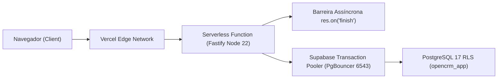

# ⚡ OpenCRM — Plataforma SaaS Multi-Tenant Metadata-Driven

<p align="center">
  
  
  
  
  
  
</p>

<p align="center">
  <strong>Plataforma SaaS Multi-Tenant orientada a metadados (Metadata-Driven), construída em React 19, Vercel Serverless (Fastify em Node.js 22), Supabase PostgreSQL 17 com RLS nativa obrigatória, blindagem de dados sensíveis sob a LGPD (Blind Index + AES-256-GCM) e motor dinâmico de lojas.</strong>
</p>

---

### 🌐 Ambientes Oficiais em Produção (Live)

| Recurso | Destino / Status | Link de Acesso |
| :--- | :--- | :--- |
| **Aplicação Web (Produção)** | **Vercel Live (Full-Stack SPA + Serverless)** | 👉 **[https://opencrm-ashy.vercel.app](https://opencrm-ashy.vercel.app)** |
| **Backend API (Healthcheck)** | Rota Leve Zero-Leak (`GET /api/health`) | **[https://opencrm-ashy.vercel.app/api/health](https://opencrm-ashy.vercel.app/api/health)** |
| **Banco de Dados Relacional** | Supabase Cloud (PostgreSQL 17 com RLS real) | `strzjawgrmdefpjioqcj.supabase.co` |
| **Repositório Oficial** | GitHub Oficial (Branches `main` e `dev`) | **[https://github.com/ThiagoIbrahimVieira/opencrm](https://github.com/ThiagoIbrahimVieira/opencrm)** |

---

## 🎯 O que é o Projeto?

O **OpenCRM** é uma plataforma corporativa completa de CRM, controle de estoque e ponto de venda (PDV) que soluciona o clássico problema dos ERPs tradicionais: **a rigidez de esquemas**. 

Em vez de forçar lanchonetes ou lojas de roupas a conviverem com campos de IMEI e números de série, ou empurrar o negócio para planilhas e soluções no-code sem segurança, o OpenCRM utiliza um **motor orientado a metadados (*Metadata-Driven*)** sobre um banco relacional **PostgreSQL 17**:

```
Navegador do Usuário / Balcão ───► Vercel Edge Network & Serverless Function (Fastify)
                                                   │
                       ┌───────────────────────────┴───────────────────────────┐
                       ▼                                                       ▼
            [Multi-Tenant RLS 🛡️]                                    [Motor Metadata-Driven ⚡]
   Supabase PostgreSQL 17 Cloud:                                    Cada loja define seus campos:
   - FORCE ROW LEVEL SECURITY                                       - Celulares (IMEI & Garantia QR)
   - Role restrita opencrm_app                                      - Lanchonetes (Lotes & Validade)
   - Criptografia AES-256-GCM                                       - Moda (Grade de Tamanho & Cores)
   - Blind Index HMAC-SHA256                                        - Outros / Personalizado do Zero!
```

---

## 📸 Vitrine Visual do Sistema (Produção)

Abaixo estão as evidências reais de funcionamento capturadas no ambiente de produção oficial do OpenCRM:

| Balcão & Resumo Operacional | Motor de Templates (Store Wizard) |
| :---: | :---: |
|  |  |
| **1. Visão Executiva & Balcão:** Painel operacional com métricas em tempo real, volume de vendas, atalhos ágeis de atendimento e monitoramento de estoque mínimo em estética *Warm Editorial Boutique*. | **2. Motor Metadata-Driven:** Assistente dinâmico de lojas que permite configurar campos personalizados, regras de serialização, tolerâncias e validações Zod sem alterar o schema do banco. |

| Checkout Transacional & Termo com QR Code | Governança, Livro Razão & Auditoria LGPD |
| :---: | :---: |
|  |  |
| **3. Saída com Blind Index & Comprovante:** Busca instantânea por CPF criptografado, baixa atômica de estoque, geração de termo com QR Code vetorial SVG e compartilhamento nativo via WhatsApp. | **4. Trilha Imutável de Auditoria (LGPD):** Registro criptográfico de acessos a PII (revelação de CPF/Telefone com log de IP e ator), além do Livro Razão (*Stock Ledger*) de movimentações. |

---

## ✨ Recursos Principais

- 🏢 **Multi-Tenancy com RLS Nativa (PostgreSQL 17):** Isolamento forçado em nível de banco via role `opencrm_app` e `FORCE ROW LEVEL SECURITY`. Impossível um tenant acessar dados de outro, mesmo sob injeção de SQL.
- 🧬 **Motor de Templates Metadata-Driven (`JSONB` + Zod):** Criação de novas lojas com campos personalizados em tempo de execução sem migrações de DDL, acelerado por índices `GIN`.
- 🔒 **AppSec & LGPD By Design:**
  - **Blind Index HMAC-SHA256:** Busca instantânea $O(1)$ por CPF e deduplicação sem armazenar texto plano e sem descriptografar a tabela inteira.
  - **AES-256-GCM:** Criptografia simétrica com IV aleatório de 12 bytes e Auth Tag de 16 bytes para CPFs e telefones.
  - **Trilha Imutável de Auditoria (Art. 18):** Logs perpétuos de revelação de dados sensíveis com IP real, ator, cargo e timestamp.
- ⚡ **Checkout ACID & Anti-Concorrência:** Baixa atômica de estoque com verificação condicional em única transação e suporte a chave de idempotência (`Idempotency-Key`).
- 📱 **Geração de Termo com QR Code & WhatsApp:** Comprovantes e certificados de garantia com QR Code vetorial SVG e link direto para WhatsApp com mensagem pré-formatada.
- 🎨 **Warm Editorial Boutique UI:** Interface autoral em React 19 e Tailwind CSS v4, com paleta neutra refinada (`#F4F2EC`, `#4F5A47`), tipografia humanista e microinterações fluidas via Motion.
- 🔑 **Autenticação Robusta:** Suporte a Google OAuth 2.0 federado e fluxo tradicional com Argon2id, cookies `HttpOnly`, `SameSite=Lax`, `Secure` e rotação RFC 6819 de refresh tokens.

---

## ⚡ Guia Rápido de Instalação (3 Passos)

```bash
# 1. Clone o repositório e instale as dependências
git clone https://github.com/ThiagoIbrahimVieira/opencrm.git
cd opencrm && npm install --legacy-peer-deps
cd server && npm install --legacy-peer-deps && cd ..

# 2. Configure o banco e execute as migrações com seed
cd server
cp .env.example .env
npm run db:deploy && npm run db:seed
cd ..

# 3. Inicie os servidores locais
cd server && npm run dev    # Terminal 1: Backend Fastify (porta 3333)
npm run dev                 # Terminal 2: Frontend Vite (porta 3000)
```

*Acesse a aplicação no navegador em `http://localhost:3000`.*

---

## 📚 Documentação Detalhada por Seções

Para manter o projeto organizado e modular, a documentação técnica foi dividida em manuais dedicados:

| Documento | Conteúdo |
| :--- | :--- |
| 🎯 [**01. Visão Geral e Problema Resolvido**](docs/01-visao-geral.md) | Dores de ERPs rígidos vs no-code frágil, motor metadata-driven e pilares da solução. |
| 🏛️ [**02. Topologia Arquitetural**](docs/02-topologia-arquitetural.md) | Diagramas Mermaid e ASCII, barreira assíncrona serverless e pooling PgBouncer. |
| 🛡️ [**03. Segurança da Informação & LGPD**](docs/03-seguranca-e-lgpd.md) | Fórmulas do Blind Index HMAC-SHA256, AES-256-GCM, Argon2id e trilha de auditoria (Art. 18). |
| 📊 [**04. Diagrama Entidade-Relacionamento (DER)**](docs/04-diagrama-entidade-relacionamento.md) | DER integral em Mermaid, chaves, isolamento por RLS e índices GIN sobre JSONB. |
| 💻 [**05. Stack Tecnológica Completa**](docs/05-stack-tecnologica.md) | React 19, Fastify, Prisma (rhel native), Supabase PostgreSQL 17 e design tokens. |
| 🚀 [**06. Como Executar o Projeto Localmente**](docs/06-execucao-local.md) | Passo a passo de instalação, geração de chaves de 32 bytes e credenciais de seed. |
| 🧪 [**07. Suíte de Testes e Validação**](docs/07-testes-e-qualidade.md) | Relatório dos 57 testes automatizados (24 frontend, 33 backend) e tipagem estrita. |
| ⚙️ [**08. Pipeline de CI/CD**](docs/08-pipeline-ci-cd.md) | Workflow do GitHub Actions, containers de serviço efêmeros e quality gates. |
| ⚖️ [**09. Licença e Termos de Uso**](docs/09-licenca.md) | Termos de propriedade intelectual e conformidade jurídica. |

---

## 🔬 Otimizações & Engenharia Serverless

A arquitetura do OpenCRM na nuvem foi desenhada para eliminar gargalos de concorrência e de *cold start*:



1. **Transaction Pooling com PgBouncer:** Resolução de centenas de requisições concorrentes na porta `6543`, prevenindo o esgotamento do pool de conexões do PostgreSQL sob picos serverless.
2. **Barreira Assíncrona no Serverless:** O adaptador Fastify aguarda o evento `res.on('finish')` antes de sinalizar a conclusão, impedindo congelamento de processos em background.
3. **Target Nativo RHEL:** Compilação do Prisma Client com `rhel-openssl-3.0.x`, garantindo carregamento instantâneo em containers Linux na Vercel.
4. **Isolamento Zero-Mock:** Contas reais conectam-se exclusivamente ao banco Supabase; dados de demonstração (`mockData`) são ativados unicamente no modo interativo explícito.

---

## 🧪 Testes Automatizados

O projeto conta com uma suíte de **57 testes automatizados (100% de aprovação)** cobrindo frontend e backend:

```bash
# Executar suíte de testes do Frontend (24 testes)
npm test

# Executar suíte de testes de integração, RLS e AppSec do Backend (33 testes)
cd server && npm test
```

---

## ⚖️ Licença & Aviso Legal

Desenvolvido para fins corporativos sob licença comercial proprietária. Todos os direitos reservados. O tratamento de dados pessoais realizado por instâncias deste software deve obedecer estritamente aos ditames da Lei Geral de Proteção de Dados (Lei nº 13.709/2018).

---

<p align="center">
  Desenvolvido por <strong>Thiago Ibrahim</strong> 🚀
</p>
