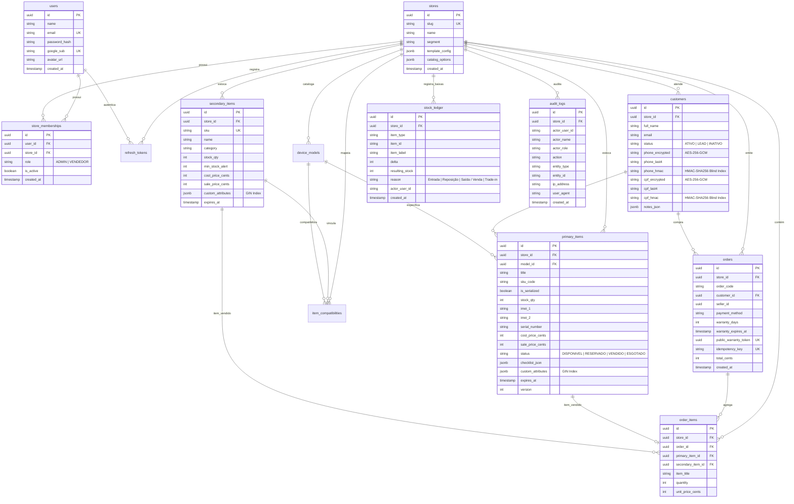

# OpenCRM — Plataforma SaaS Multi-Tenant Metadata-Driven, Vercel Serverless, Supabase PostgreSQL 17 RLS & AppSec LGPD

[](https://opencrm-ashy.vercel.app)
[](https://supabase.com)
[](https://fastify.dev)
[](https://react.dev)
[](https://github.com/ThiagoIbrahimVieira/opencrm)
[](https://github.com/ThiagoIbrahimVieira/opencrm)

> **Arquitetura Full-Stack Corporativa:** Frontend React 19 + TypeScript + Tailwind CSS (*Warm Editorial Boutique Design System*) integrado a Backend Fastify encapsulado em **Vercel Serverless Function** (`api/index.ts`), banco de dados **PostgreSQL 17 gerenciado no Supabase** com **Row-Level Security (RLS) mandatória**, blindagem de dados sensíveis (**LGPD**) via Blind Index HMAC-SHA256 e criptografia AES-256-GCM, transações **ACID** com proteção contra race conditions e motor dinâmico de templates metadata-driven.

---

### 🌐 Ambientes Oficiais em Produção (Live)

| Recurso | Destino / Status | Link de Acesso |
| :--- | :--- | :--- |
| **Aplicação Web (Produção)** | **Vercel Live (Full-Stack SPA + Serverless)** | 👉 **[https://opencrm-ashy.vercel.app](https://opencrm-ashy.vercel.app)** |
| **Backend API (Healthcheck)** | Rota Leve Zero-Leak (`GET /api/health`) | **[https://opencrm-ashy.vercel.app/api/health](https://opencrm-ashy.vercel.app/api/health)** |
| **Banco de Dados Relacional** | Supabase Cloud (PostgreSQL 17 com RLS real) | `strzjawgrmdefpjioqcj.supabase.co` |
| **Repositório Oficial** | GitHub Oficial (Branches `main` e `dev`) | **[https://github.com/ThiagoIbrahimVieira/opencrm](https://github.com/ThiagoIbrahimVieira/opencrm)** |

---

## 📸 Vitrine Visual do Sistema (Produção)

Abaixo estão as evidências reais de funcionamento capturadas no ambiente de produção oficial do OpenCRM:

| Balcão & Resumo Operacional | Motor de Templates (Store Wizard) |
| :---: | :---: |
|  |  |
| **1. Visão Executiva & Balcão:** Painel de controle operacional com métricas em tempo real, volume de vendas, atalhos ágeis de atendimento e monitoramento de estoque mínimo em estética *Warm Editorial Boutique*. | **2. Motor Metadata-Driven:** Assistente dinâmico de lojas que permite configurar campos personalizados, regras de serialização, tolerâncias e validações Zod sem alterar o schema do banco. |

| Checkout Transacional & Termo com QR Code | Governança, Livro Razão & Auditoria LGPD |
| :---: | :---: |
|  |  |
| **3. Saída com Blind Index & Comprovante:** Busca instantânea por CPF criptografado, baixa atômica de estoque, geração de termo com QR Code vetorial SVG e compartilhamento nativo via WhatsApp. | **4. Trilha Imutável de Auditoria (LGPD):** Registro criptográfico de acessos a PII (revelação de CPF/Telefone com log de IP e ator), além do Livro Razão (*Stock Ledger*) de movimentações. |

---

## 1. Visão Geral e Problema Resolvido

Sistemas de gestão tradicionais sofrem de dois extremos crônicos: ou são rígidos e engessados (forçando lojas de roupas ou lanchonetes a conviver com campos inúteis de "IMEI", "Bateria" e "Armazenamento"), ou apelam para soluções No-Code frágeis sem isolamento real de banco de dados, sem integridade relacional e com graves riscos de sanções sob a **LGPD (Lei Geral de Proteção de Dados)**.

O **OpenCRM** resolve essa dicotomia através de uma arquitetura orientada a metadados:

1. **Multi-Tenancy com RLS no PostgreSQL 17 (Supabase):** Isolamento forçado no nível de banco de dados via role restrita `opencrm_app` e políticas de RLS ativadas com `FORCE ROW LEVEL SECURITY`. Mesmo sob injeção de código, nenhuma loja tem visibilidade dos dados de outra.
2. **Motor de Templates Dinâmico (`JSONB` + Zod):** Cada loja define seus próprios atributos e comportamentos operacionais (ex: grade de tamanho e tecido para moda, tempo de preparo e validade de lote para alimentação, ou validação de IMEI via algoritmo de Luhn para smartphones).
3. **AppSec & LGPD By Design:** Criptografia simétrica `AES-256-GCM` para dados identificáveis, Blind Index determinístico `HMAC-SHA256` para busca e deduplicação sem descriptografia, auditoria imutável de revelação de dados sensíveis e autenticação segura com cookies `HttpOnly` e refresh tokens rotativos RFC 6819.
4. **Checkout Transacional ACID & Anti-Concorrência:** Baixa atômica de estoque com verificação condicional em única transação e suporte a chave de idempotência (`Idempotency-Key`), eliminando o risco de venda duplicada sob acessos simultâneos.

---

## 2. Topologia Arquitetural 100% Vercel Serverless Function + Supabase RLS

A infraestrutura do OpenCRM foi arquitetada para operar de forma unificada na **Vercel Edge & Serverless Network**, conectada ao cluster **PostgreSQL 17 no Supabase Cloud**.

### 2.1 Diagrama de Arquitetura (Mermaid)

```mermaid
flowchart TD
    subgraph CLIENT["Navegador do Usuário (Client)"]
        SPA["React 19 SPA (Tailwind CSS v4)\nWarm Editorial Boutique UI"]
        STORAGE["Cookies HttpOnly\nSameSite=Lax (First-Party)"]
    end

    subgraph VERCEL["Vercel Edge Network & Serverless Platform"]
        ROUTER{"Vercel Router\n(vercel.json)"}
        STATIC["Edge CDN\n(HTML, Chunks JS, CSS)"]
        SERVERLESS["Vercel Serverless Function\n(/api/index.ts)"]
        
        subgraph FASTIFY_CORE["Fastify App Core (Node.js 22)"]
            HELMET["@fastify/helmet & CORS Multi-Origin"]
            RATELIMIT["@fastify/rate-limit (Anti-Bruteforce)"]
            AUTH_MOD["Auth Module\n(Argon2id + JWT + Rotation RFC 6819)"]
            LGPD_MOD["LGPD Engine\n(AES-256-GCM + HMAC-SHA256 Blind Index)"]
            DOMAIN_MOD["Módulos de Domínio\n(Stores, Inventory, Orders, Audit)"]
            ASYNC_BARRIER["Barreira Assíncrona\nres.on('finish')"]
        end
    end

    subgraph SUPABASE["Supabase Cloud (PostgreSQL 17)"]
        POOLER["Supabase Transaction Pooler\n(Porta 6543 / PgBouncer)"]
        DIRECT["Direct Session\n(Porta 5432 / Migrations)"]
        
        subgraph PG_ENGINE["PostgreSQL Engine"]
            ROLE["Role da Aplicação:\nopencrm_app"]
            RLS_GATE["FORCE ROW LEVEL SECURITY\nSET LOCAL app.current_store_id"]
            TABLES[("Tabelas Multi-Tenant\n(Stores, Users, Items, Customers, Orders)")]
            GIN_IDX[("Índices GIN JSONB\n(custom_attributes)")]
            AUDIT_TAB[("Audit Logs & Stock Ledger\n(Imutabilidade LGPD)")]
        end
    end

    SPA -->|1. Requisições SPA| ROUTER
    STORAGE -.->|Headers de Cookie| ROUTER
    ROUTER -->|/(.*) SPA Fallback| STATIC
    ROUTER -->|/api/:path* Rewrite| SERVERLESS
    SERVERLESS --> FASTIFY_CORE
    FASTIFY_CORE --> HELMET --> RATELIMIT --> AUTH_MOD & LGPD_MOD & DOMAIN_MOD
    DOMAIN_MOD --> ASYNC_BARRIER
    FASTIFY_CORE -->|2. Conexão Pooling Prisma| POOLER
    POOLER --> ROLE
    ROLE --> RLS_GATE
    RLS_GATE --> TABLES
    RLS_GATE --> GIN_IDX
    RLS_GATE --> AUDIT_TAB
```

### 2.2 Diagrama de Topologia de Rede (ASCII)

```
   ┌─────────────────────────────────────────────────────────────────────────┐
   │                          NAVEGADOR DO USUÁRIO                           │
   │                  (https://opencrm-ashy.vercel.app)                      │
   └────────────────────┬────────────────────────────────▲───────────────────┘
                        │                                │
                        │ 1. Navegação SPA               │ Cookies HttpOnly
                        │    (HTML / CSS / Chunks JS)    │ SameSite=Lax (First-Party)
                        ▼                                │
   ┌─────────────────────────────────────────────────────┴───────────────────┐
   │                       VERCEL EDGE NETWORK                               │
   │                                                                         │
   │   • Rewrites declarativos (`vercel.json`):                              │
   │     1) `/api/:path*`  ──▶  Serverless Function (`api/index.ts`)         │
   │     2) `/(.*)`        ──▶  /index.html (SPA Fallback)                   │
   └────────────────────┬────────────────────────────────────────────────────┘
                        │
                        │ 2. Chamada Serverless First-Party
                        │    (Sem problemas de CORS Cross-Domain)
                        ▼
   ┌─────────────────────────────────────────────────────────────────────────┐
   │             VERCEL SERVERLESS FUNCTION (NODE.JS / FASTIFY)              │
   │                            (api/index.ts)                               │
   │                                                                         │
   │   • Adaptador Serverless com barreira assíncrona (`res.on('finish')`)   │
   │   • Fastify Instance (`trustProxy: true` para captura correta de IP)    │
   │   • Helmet AppSec Headers & Anti-Bruteforce Rate Limiting               │
   │   • Rota Leve `GET /api/health` ──▶ 200 OK (Zero-Leak)                  │
   │   • Auth Module: Argon2id, JWT Rotation, Google OAuth 2.0               │
   │   • LGPD Engine: Blind Index HMAC-SHA256 + Criptografia AES-256-GCM     │
   │   • Engine Prisma com target binário nativo `rhel-openssl-3.0.x`        │
   └────────────────────┬────────────────────────────────────────────────────┘
                        │
                        │ 3. Prisma Connection Pooling & RLS Enforcement
                        │    (SET LOCAL "app.current_store_id" = $tenant)
                        ▼
   ┌─────────────────────────────────────────────────────────────────────────┐
   │                     SUPABASE CLOUD (POSTGRESQL 17)                      │
   │                    (Projeto: strzjawgrmdefpjioqcj)                      │
   │                                                                         │
   │   • Transaction Pooler (porta 6543) com PgBouncer                       │
   │   • Schema Multi-Tenant com RLS forçado em todas as tabelas             │
   │   • Role de Aplicação: `opencrm_app` (Sem privilégios de superusuário)  │
   │   • Índices GIN sobre colunas JSONB (`custom_attributes`)               │
   │   • Trilha imutável de Auditoria LGPD e Livro Razão de Estoque          │
   └─────────────────────────────────────────────────────────────────────────┘
```

---

## 3. Segurança da Informação & Engenharia LGPD By Design

A conformidade com a **Lei Geral de Proteção de Dados (Lei nº 13.709/2018)** foi desenhada na raiz da arquitetura do OpenCRM:

| Vetor de Segurança | Implementação no OpenCRM | Benefício Prático & Conformidade |
| :--- | :--- | :--- |
| **Isolamento de Tenants (RLS)** | `SET LOCAL ROLE opencrm_app` + `set_config('app.current_store_id')` | Mesmo sob injeção de código ou falha de filtro no backend, o banco veta acessos a lojas distintas. |
| **Proteção de PII (Art. 46)** | Criptografia simétrica `AES-256-GCM` com IV aleatório de 12 bytes + Auth Tag | Se o banco de dados for exfiltrado, dados sensíveis (CPF, telefone) permanecem matematicamente ilegíveis. |
| **Busca & Deduplicação Segura** | Blind Index determinístico via `HMAC-SHA256` (`PII_HMAC_KEY_HEX`) | Permite busca exata `O(1)` e verificação de duplicidade de CPF/Telefone sem jamais descriptografar a tabela inteira. |
| **Auditoria Imutável (Art. 18)** | Registro em `audit_logs` a cada ação de revelação de PII | Rastreia quem (`actor`), qual função (`role`), quando (`timestamp`), de onde (`ip_address`) e por quê visualizou o dado. |
| **Armazenamento de Senhas** | `Argon2id` (WebAssembly nativo) com parâmetros recomendados pela OWASP | Resistência extrema a ataques de dicionário, força bruta e aceleração via GPU/FPGA/ASIC. |
| **Sessão & Tokens** | Cookies `HttpOnly`, `SameSite=Lax`, `Secure` + Rotação RFC 6819 | Tokens inacessíveis via JavaScript (proteção total contra XSS). Reuso de token revogado derruba toda a família de sessões. |
| **Anti-Vazamento em DTOs** | Serialização condicional por RBAC (`ADMIN` vs `VENDEDOR`) | Vendedores recebem apenas dados de balcão e preço de venda; custos, margens e segredos fiscais são expurgados no backend. |
| **Consulta Pública Segura** | Rota pública de garantia isolada por UUID v4 criptográfico | Clientes consultam validade e termos via QR Code; o endpoint omite 100% de CPF, custos e dados pessoais de terceiros. |

### 3.1 Mecânica do Blind Index HMAC-SHA256
Para viabilizar consultas rápidas de clientes por CPF sem armazená-los em texto plano e sem violar a LGPD:
1. **Normalização:** O CPF é limpo de qualquer máscara (`\D` substituído por vazio).
2. **Hash Criptográfico:** Aplica-se `HMAC-SHA256` utilizando a chave mestra isolada `PII_HMAC_KEY_HEX`.
3. **Indexação:** O hash gerado é gravado na coluna `cpf_hmac` com índice B-Tree convencional.
4. **Consulta:** Ao buscar por CPF no balcão, o backend gera o HMAC do termo pesquisado e executa `SELECT ... WHERE cpf_hmac = $hmac`, preservando a privacidade integral dos dados.

### 3.2 Mecânica da Criptografia AES-256-GCM
1. Cada valor de CPF e Telefone é criptografado com um vetor de inicialização (**IV**) criptograficamente pseudo-aleatório de 12 bytes.
2. A cifra produz um texto criptografado e uma **Tag de Autenticação** de 16 bytes que valida a integridade dos bytes cifrados.
3. Formato serializado canônico gravado no banco: `iv_hex:auth_tag_hex:ciphertext_hex`.

---

## 4. Diagrama Entidade-Relacionamento (DER)



---

## 5. Stack Tecnológica Completa

- **Frontend SPA:**
  - **Framework:** React 19 + TypeScript + Vite 8.
  - **Estilização:** Tailwind CSS v4 (*Warm Editorial Boutique Design System*, paleta boutique `#F4F2EC`, oliva `#4F5A47`, tipografia humanista e zero componentes de formulário nativos).
  - **Ícones & Motion:** Lucide React + Motion (`framer-motion` v12).
  - **Gerenciamento de Estado:** Padrão desacoplado com `useSyncExternalStore` + snapshots reativos.
- **Backend API & Serverless:**
  - **Plataforma:** Vercel Serverless Function (`api/index.ts`) com Node.js 22.
  - **Framework:** Fastify v4 + TypeScript.
  - **ORM:** Prisma ORM com binaryTargets `rhel-openssl-3.0.x` para execução serverless sem latência de compilação.
  - **Segurança:** `@fastify/helmet`, `@fastify/cors`, `@fastify/rate-limit`, `@fastify/cookie`.
  - **Autenticação:** Argon2id (WebAssembly), JWT com rotação de refresh tokens, Google OAuth 2.0.
- **Banco de Dados:**
  - **Engine:** PostgreSQL 17 gerenciado no Supabase.
  - **Conexão:** Supabase Transaction Pooler (PgBouncer, porta 6543) com fallback direto na porta 5432.
  - **Políticas:** RLS nativa com `FORCE ROW LEVEL SECURITY` e role de aplicação `opencrm_app`.
  - **Indexação Avançada:** Índices B-Tree para identificadores e GIN para colunas `JSONB` de atributos dinâmicos.
- **Qualidade & Testes:**
  - **Test Runner:** Vitest + Node Test Runner nativo.
  - **Resultados:** **57 testes automatizados aprovados (100% PASS)**:
    - 24 testes unitários e de integração no frontend.
    - 33 testes de segurança, AppSec, criptografia e RLS no backend.

---

## 6. Como Executar o Projeto Localmente

### Pré-requisitos
- Node.js 20+ (testado em v22 e v26)
- npm ou pnpm
- Uma instância PostgreSQL 16+ (local via Docker ou projeto Supabase Cloud)

### Passo 1: Clonar o Repositório e Instalar Dependências

```bash
# 1. Clonar o repositório
git clone https://github.com/ThiagoIbrahimVieira/opencrm.git
cd opencrm

# 2. Instalar dependências da raiz (Frontend)
npm install --legacy-peer-deps

# 3. Instalar dependências do Backend
cd server
npm install --legacy-peer-deps
cd ..
```

### Passo 2: Configurar as Variáveis de Ambiente no Backend

Crie o arquivo `server/.env` a partir do modelo `server/.env.example`:

```bash
cp server/.env.example server/.env
```

Gere chaves criptográficas fortes de 32 bytes (64 caracteres hexadecimais):
```bash
node -e "console.log('PII_ENCRYPTION_KEY_HEX=' + crypto.randomBytes(32).toString('hex'))"
node -e "console.log('PII_HMAC_KEY_HEX=' + crypto.randomBytes(32).toString('hex'))"
```

Configure em `server/.env`:
- `DATABASE_URL`: URL do Transaction Pooler do Supabase (porta `6543`) com `?pgbouncer=true` (ou Postgres local).
- `DIRECT_URL`: URL direta do Supabase (porta `5432`) para execução das migrações do Prisma.
- `JWT_ACCESS_SECRET`: Segredo de no mínimo 32 caracteres para JWT.
- `JWT_REFRESH_SECRET`: Segredo de no mínimo 32 caracteres para Refresh Token.
- `PII_ENCRYPTION_KEY_HEX`: Chave gerada acima.
- `PII_HMAC_KEY_HEX`: Chave gerada acima.

### Passo 3: Executar Migrações e Popular o Banco (Seed Idempotente)

```bash
cd server

# Gerar o Prisma Client
npm run db:generate

# Aplicar a migration com tabelas, índices GIN, role opencrm_app e RLS
npm run db:deploy

# Executar o seed idempotente com as 3 lojas de demonstração
npm run db:seed
```

> **Lojas pré-configuradas no Seed:**
> 1. **AuraCell — Loja Jardins:** Segmento Celulares & Assistência Técnica (controle serializado com validação de algoritmo de Luhn, trade-in, checklist e termo de garantia com QR Code).
>    - Admin: `thiago@auracell.com.br` / `admin123`
>    - Vendedor: `camila@auracell.com.br` / `vendedor123`
> 2. **Sabor & Brasa:** Segmento Lanchonete & Hamburgueria (itens por quantidade `stock_qty`, controle de validade de lote e sem serialização).
>    - Admin: `chef@saborbrasa.com.br` / `admin123`
> 3. **Atelier Linho:** Segmento Moda & Vestuário (grade de tamanhos e tecidos com garantia de troca de 30 dias via QR Code).
>    - Admin: `estilo@atelierlinho.com.br` / `admin123`

### Passo 4: Iniciar os Servidores Locais

```bash
# Terminal 1: Iniciar o Backend Fastify (porta 3333)
cd server
npm run dev

# Terminal 2: Iniciar o Frontend Vite (porta 3000)
npm run dev
```

Abra seu navegador em `http://localhost:3000`.

---

## 7. Execução da Suíte de Testes e Validação de Tipagem

```bash
# 1. Validação estática de tipagem TypeScript (zero erros aceitos)
npm run lint

# 2. Suíte de testes automatizados do Frontend (24 testes)
npm test

# 3. Suíte de testes de integração, RLS e AppSec do Backend (33 testes)
cd server
npm test
cd ..

# 4. Build de produção do Frontend
npm run build
```

---

## 8. Pipeline de CI/CD (GitHub Actions)

O pipeline `.github/workflows/ci.yml` é executado automaticamente em cada push ou pull request nas branches `dev` e `main`:
1. Inicializa um container de serviço `postgres:16-alpine`.
2. Executa `tsc --noEmit` (TypeScript strict mode) no frontend e backend.
3. Executa a suíte de testes unitários do frontend (`npm test`).
4. Executa o build de produção Vite (`vite build`).
5. Aplica as migrações SQL do Prisma e o script RLS `rls.sql`.
6. Popula o banco com a seed de dados de teste.
7. Executa a suíte de testes de integração com Vitest e Fastify.

---

## 9. Licença

Este projeto é desenvolvido para uso corporativo sob licença proprietária. Todos os direitos reservados.
