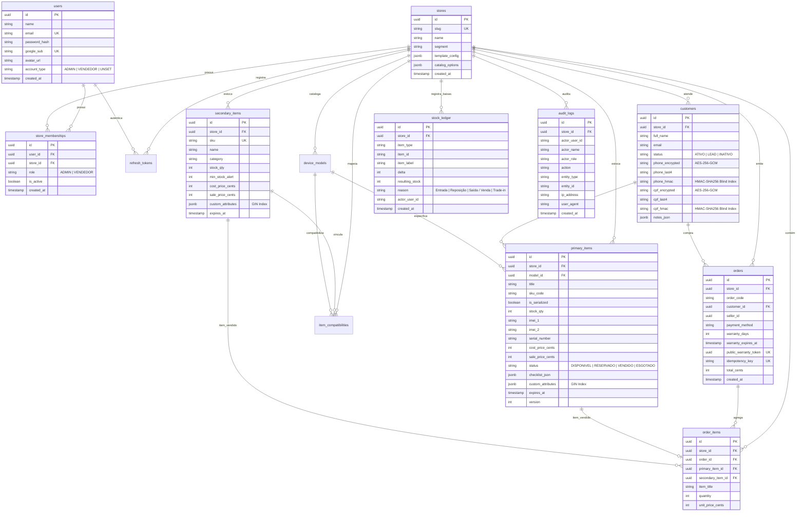

# 4. Diagrama Entidade-Relacionamento (DER) — OpenCRM

> **Módulo de Documentação Oficial:** Este documento detalha o modelo relacional de dados, chaves primárias, relacionamentos, tipagem e estratégias de indexação GIN/B-Tree do **OpenCRM**.

---

## 1. Diagrama Entidade-Relacionamento Completo (Mermaid)



---

## 2. Destaques e Otimizações de Esquema

### 2.1 Isolamento RLS por `store_id`
Todas as tabelas do domínio de negócio possuem a chave estrangeira `store_id UUID NOT NULL REFERENCES stores(id)`. Sobre ela atua a política de RLS em nível de banco:
```sql
CREATE POLICY store_isolation_policy ON primary_items
  FOR ALL
  USING (store_id = current_setting('app.current_store_id')::uuid);
```

### 2.2 Estratégia de Indexação GIN em `custom_attributes`
Para garantir consultas instantâneas dentro das propriedades dinâmicas do JSONB de cada segmento (ex: IMEI, grade de cores, tamanho de vestuário ou lote de alimentos):
```sql
CREATE INDEX idx_primary_items_custom_attributes 
  ON primary_items USING GIN (custom_attributes);

CREATE INDEX idx_secondary_items_custom_attributes 
  ON secondary_items USING GIN (custom_attributes);
```

### 2.3 Livro Razão de Estoque (`stock_ledger`)
A cada venda, reposição, ajuste ou devolução, o sistema grava um registro imutável no `stock_ledger` contendo o `delta` (ex: `-1`, `+5`) e o `resulting_stock`. Isso possibilita auditoria contábil completa de qualquer divergência física de inventário.
