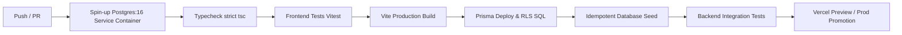

# 8. Pipeline de CI/CD (GitHub Actions) — OpenCRM

> **Módulo de Documentação Oficial:** Este documento descreve os estágios de automação, suíte de integração contínua e critérios de bloqueio (*Quality Gates*) do pipeline do **OpenCRM**.

---

## 1. Visão Geral do Pipeline

O OpenCRM adota um fluxo de Integração Contínua obrigatório configurado em `.github/workflows/ci.yml`. Qualquer alteração enviada via `push` ou aberta em `Pull Request` para as branches `main` ou `dev` dispara automaticamente a esteira de validação.

---

## 2. Etapas Detalhadas do Workflow

### Etapa 1: Ambiente de Execução & Container de Serviço
* **Sistema Operacional:** `ubuntu-latest`.
* **Serviço de Banco de Dados:** Container Docker efêmero rodando `postgres:16-alpine`.
* **Saúde do Banco:** Healthcheck automatizado com `pg_isready` antes da execução dos passos dependentes.

### Etapa 2: Instalação e Cache de Dependências
* Configuração do runtime **Node.js 22** com cache nativo do `npm`.
* Resolução estrita de pacotes no frontend (`/`) e no backend (`/server`).

### Etapa 3: Checagem de Tipagem e Testes Unitários de Frontend
* Execução do TypeScript strict check (`tsc --noEmit`).
* Bateria de testes de componentes e lógica de interface via `vitest run`.
* Compilação do build de produção via `npm run build` para garantir que o bundle final não possui inconsistências de importação.

### Etapa 4: Banco de Dados de Integração e Migrações
* Geração do cliente Prisma (`npx prisma generate`).
* Aplicação das migrações SQL no banco efêmero (`npx prisma migrate deploy`).
* Aplicação das políticas nativas de Row-Level Security (`rls.sql`).
* Carga do seed de dados de teste (`npm run db:seed`).

### Etapa 5: Testes de Integração e AppSec de Backend
* Execução da suíte completa de testes de segurança, conformidade LGPD, isolamento multi-tenant e concorrência transacional.
* Se qualquer teste falhar, o build é abortado imediatamente e o merge é bloqueado.

---

## 3. Critérios de Bloqueio (*Quality Gates*)

Para que um pull request possa ser integrado às branches protegidas:
1. **Passagem de 100% dos testes:** Nenhuma falha tolerada.
2. **Zero erros de tipagem:** TypeScript em strict mode sem uso de `any`.
3. **Build limpo:** Sem referências quebradas ou bibliotecas incompatíveis com o bundle final.
